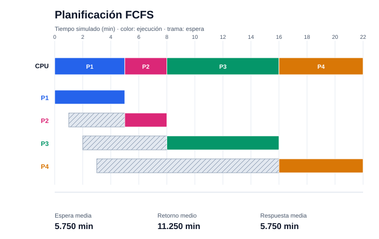
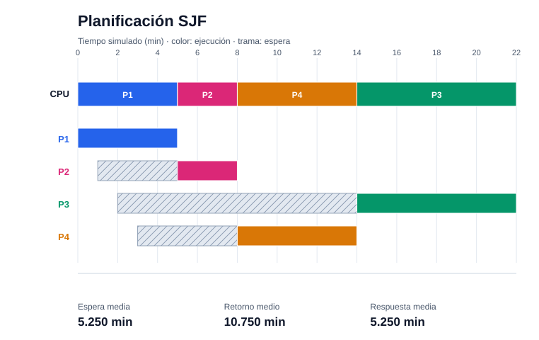
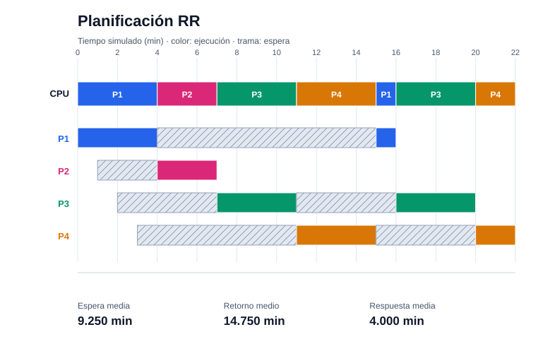
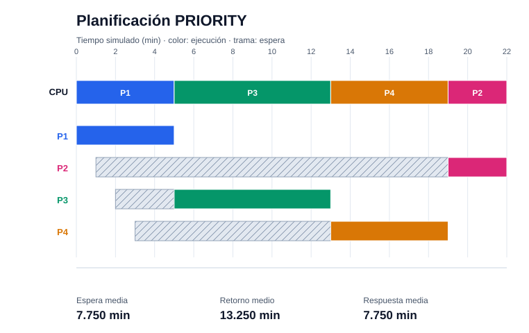

# Informe técnico Beta — planificación y memoria

**Estado de la evidencia:** los cálculos de QA se contrastaron con los ejecutables C integrados para CPU y memoria. Las trazas C y los gráficos generados a partir de ellas se guardan en este informe. La prueba existente del endpoint web confirma la anomalía de Belady; la exposición de la traza completa de reemplazo en la web sigue pendiente.

## 1. Alcance, datos y método

Se usaron los casos numéricos del `plan_de_sprints_yakcheos_6_modulos.md`, secciones 2.1, 2.3 y tarea S3.1. Los datos de CPU están en [`tests_python/fixtures/procesos_semana4.json`](../tests_python/fixtures/procesos_semana4.json); los de paginación y segmentación, en [`tests_python/fixtures/memoria_semana6.json`](../tests_python/fixtures/memoria_semana6.json). Se verificó que esta última coincide numéricamente con `data/memoria_semana6.json`. El patrón de reemplazo es `1,2,3,4,1,2,5,1,2,3,4,5`, con 3 y 4 marcos. Las pruebas compilan y ejecutan C con `gcc -std=c11 -Wall -Wextra -Werror`; comparan sus números con los oráculos independientes de Python.

Para reproducir la evidencia desde la raíz del repositorio:

```powershell
python tests_python/generate_gantt.py --input docs/traces/cpu_fcfs.json --output-dir docs/gantt
python tests_python/generate_gantt.py --input docs/traces/cpu_sjf.json --output-dir docs/gantt
python tests_python/generate_gantt.py --input docs/traces/cpu_rr.json --output-dir docs/gantt
python tests_python/generate_gantt.py --input docs/traces/cpu_priority.json --output-dir docs/gantt
python tests_python/memory_audit.py
python tests_python/page_replacement.py --file tests_python/fixtures/referencias_belady_3marcos.json
python tests_python/page_replacement.py --file tests_python/fixtures/referencias_belady_4marcos.json
python -m pytest -q tests_python
go test ./cmd/server -run TestPageReplacementBeladyAnomaly -v
```

Para ejecutar **toda** la suite Go, los endpoints de CPU y memoria necesitan los ejecutables C en `bin/`. En sistemas con `make`, se generan con `make -C src/core_c`. En Windows, si `make` no está instalado pero `gcc` sí, desde la raíz del repositorio se puede usar:

```powershell
New-Item -ItemType Directory -Path bin -Force | Out-Null
gcc -std=c11 -Wall -Wextra -Werror -O2 -o bin/scheduler.exe src/core_c/queue.c src/core_c/scheduler_nonpreemptive.c src/core_c/scheduler_preemptive.c src/core_c/scheduler.c
gcc -std=c11 -Wall -Wextra -Werror -O2 -o bin/memory_translate.exe src/core_c/memory_translate.c
go test ./...
```

Los binarios locales están ignorados por Git y se deben reconstruir después de cambiar las fuentes C.

Los cuatro `cpu_*.json` son salidas guardadas del planificador C integrado, ejecutado con `--algo`, `--file tests_python/fixtures/procesos_semana4.json`, `--quantum 4` y `--out`. La suite de QA genera archivos temporales `cpu_timeline.json` y compara doce casos C con el oráculo, incluidos el orden de llegadas en RR y el envejecimiento. También comprueba que las cuatro trazas y sus SVG guardados coincidan con el ejecutable actual. El generador de Gantt acepta esos JSON individuales por `--input`.

## 2. Planificación de CPU y Gantt

Los minutos son ticks simulados. Para cada proceso, `retorno = finalización − llegada`, `espera = retorno − ráfaga` y `respuesta = primer inicio − llegada`. El oráculo emplea llegada y PID para desempatar, y en RR coloca las llegadas ocurridas hasta el final del quantum antes de reinsertar el proceso desalojado.

| Algoritmo | Espera media (min) | Retorno medio (min) | Respuesta media (min) | Traza C | Diagrama |
|---|---:|---:|---:|---|---|
| FCFS | 5.750 | 11.250 | 5.750 | [JSON](traces/cpu_fcfs.json) | [SVG](gantt/gantt_fcfs.svg) |
| SJF no apropiativo | 5.250 | 10.750 | 5.250 | [JSON](traces/cpu_sjf.json) | [SVG](gantt/gantt_sjf.svg) |
| RR, quantum 4 | 9.250 | 14.750 | 4.000 | [JSON](traces/cpu_rr.json) | [SVG](gantt/gantt_rr.svg) |
| Prioridad no apropiativa | 7.750 | 13.250 | 7.750 | [JSON](traces/cpu_priority.json) | [SVG](gantt/gantt_priority.svg) |

Los cuatro resultados C coinciden con el oráculo y los promedios de espera exigidos por el plan. Los SVG se generaron desde esas trazas C; muestran la secuencia de CPU, los tramos de espera entre llegada y ejecución, eje de tiempo, color por proceso y los tres promedios. El motor C omite intervalos inactivos del JSON; el generador los reconstruye a partir de los tiempos y comprueba que no haya procesos listos durante ellos.









## 3. Auditoría de memoria

### 3.1 Asignación contigua y fragmentación externa

First Fit elige el primer hueco suficiente; Best Fit elige el más pequeño que alcance para la solicitud. Ambos requieren un hueco **contiguo**. Sumar toda la memoria libre no basta para decidir si cabe un bloque. Esta distinción corresponde a la asignación contigua descrita en la sección 9.2 de *Operating System Concepts* y al capítulo de administración de memoria de *Modern Operating Systems*. El mapa siguiente es la [salida real del caso `--mode fragmentation` del motor C](traces/memoria_fragmentacion_c.json), contrastada con `fragmentation()` de Python. [Silberschatz, Galvin y Gagne (Wiley)](https://www.wiley-vch.de/en/areas-interest/computing-computer-sciences/computer-science-17cs/general-introductory-computer-science-17cs0/silberschatz-39-s-operating-system-concepts-978-1-119-45408-3), [Tanenbaum y Bos (Pearson)](https://www.pearson.com/en-us/subject-catalog/p/modern-operating-systems/P200000003295/9780137618934).

| Bloque en la salida C | Inicio | Tamaño | Estado |
|---|---:|---:|---|
| 1 | 0 | 2 | Libre |
| 2 | 2 | 2 | Ocupado por PID 2 |
| 3 | 4 | 2 | Libre |
| 4 | 6 | 2 | Ocupado por PID 4 |
| 5 | 8 | 2 | Libre |

**Solicitud:** 3 unidades contiguas. **Resultado observado:** C emite `external_fragmentation: true` y una alerta de rechazo; hay 6 unidades libres en total, pero el hueco mayor tiene 2. El oráculo `fragmentation()` reproduce ese dictamen a partir de los bloques devueltos por C. La prueba de QA ejecuta el motor C y comprueba ambos resultados.

### 3.2 Paginación y traducción

Con páginas y marcos de **4096 bytes**, la dirección virtual **10000** se descompone en página `10000 // 4096 = 2` y desplazamiento `10000 % 4096 = 1808`. La tabla documentada asigna la página 2 al marco 7; por tanto, `7 × 4096 + 1808 = 30480` es la dirección física. El oráculo [`memory_audit.py`](../tests_python/memory_audit.py) y los dos ejecutables C (`memory_cli` y `memory_translate`) produjeron esos valores. Se conserva la [traza de `memory_cli --mode paging --vaddr 10000`](traces/memoria_paginacion_c.json). El marco teórico de paginación está en la sección 9.3 de [*Operating System Concepts* (Wiley)](https://www.wiley-vch.de/en/areas-interest/computing-computer-sciences/computer-science-17cs/general-introductory-computer-science-17cs0/silberschatz-39-s-operating-system-concepts-978-1-119-45408-3).

### 3.3 Segmentación y límites

El límite es la **longitud** del segmento: solo son válidos los desplazamientos `0 <= offset < límite`. La tabla del plan es:

| Segmento | Base | Límite | Rango físico válido |
|---|---:|---:|---|
| 0, Código | 1000 | 400 | 1000–1399 |
| 1, Datos | 5200 | 800 | 5200–5999 |
| 2, Pila | 9000 | 300 | 9000–9299 |

Para Datos, `(1, 300)` se traduce a `5200 + 300 = 5500`. `(1, 900)` excede el límite y produce `EXCEPTION_SEGMENTATION_FAULT`. El desplazamiento **800**, igual al límite, también falla. Estos resultados se verificaron en Python y en ambos ejecutables C. Se guardaron las trazas C de [acceso válido](traces/memoria_segmentacion_valida_c.json) y [fallo](traces/memoria_segmentacion_trap_c.json).

## 4. Reemplazo de páginas: FIFO, LRU y Óptimo

Los tres algoritmos reciben exactamente la misma secuencia y capacidad. FIFO expulsa la página residente más antigua; LRU, la menos usada recientemente; Óptimo elige la página cuyo próximo uso está más lejos, usando el futuro de la secuencia **solo como referencia teórica**. Se cuentan fallos cuando la página solicitada no está en los marcos. Las salidas completas contienen, para cada referencia, posición, página, marcos, acierto/fallo y víctima. El marco teórico de reemplazo corresponde a la sección 10.4 de [*Operating System Concepts* (Wiley)](https://www.wiley-vch.de/en/areas-interest/computing-computer-sciences/computer-science-17cs/general-introductory-computer-science-17cs0/silberschatz-39-s-operating-system-concepts-978-1-119-45408-3) y al capítulo 3 de [*Modern Operating Systems* (Pearson)](https://www.pearson.com/en-us/subject-catalog/p/modern-operating-systems/P200000003295/9780137618934).

| Marcos | FIFO: fallos / aciertos | LRU: fallos / aciertos | Óptimo: fallos / aciertos | Traza JSON |
|---:|---:|---:|---:|---|
| 3 | 9 / 3 | 10 / 2 | 7 / 5 | [Traza completa](traces/reemplazo_3marcos.json) |
| 4 | 10 / 2 | 8 / 4 | 6 / 6 | [Traza completa](traces/reemplazo_4marcos.json) |

Al subir de 3 a 4 marcos, FIFO pasa de **9 a 10 fallos**: reproduce la anomalía de Belady requerida. Óptimo tiene menos fallos que FIFO y LRU en ambas capacidades. Esto no implica que LRU supere siempre a FIFO: en esta secuencia con 3 marcos, LRU tiene un fallo más.

Detalle de FIFO con 3 marcos (cada fila es un acceso; `–` indica marco aún libre):

| Índice | Página | Marcos tras acceso | Resultado | Víctima |
|---:|---:|---|---|---:|
| 0 | 1 | 1, –, – | Fallo | – |
| 1 | 2 | 1, 2, – | Fallo | – |
| 2 | 3 | 1, 2, 3 | Fallo | – |
| 3 | 4 | 4, 2, 3 | Fallo | 1 |
| 4 | 1 | 4, 1, 3 | Fallo | 2 |
| 5 | 2 | 4, 1, 2 | Fallo | 3 |
| 6 | 5 | 5, 1, 2 | Fallo | 4 |
| 7 | 1 | 5, 1, 2 | Acierto | – |
| 8 | 2 | 5, 1, 2 | Acierto | – |
| 9 | 3 | 5, 3, 2 | Fallo | 1 |
| 10 | 4 | 5, 3, 4 | Fallo | 2 |
| 11 | 5 | 5, 3, 4 | Acierto | – |

Las entradas para repetirlo están en [`referencias_belady_3marcos.json`](../tests_python/fixtures/referencias_belady_3marcos.json) y [`referencias_belady_4marcos.json`](../tests_python/fixtures/referencias_belady_4marcos.json). `page_replacement.py` acepta esos JSON por `--file` o por `stdin`; emite un objeto con FIFO, LRU y OPTIMAL y sus trazas completas. La prueba Go `TestPageReplacementBeladyAnomaly` del endpoint `/api/v1/memory/replace` pasó y verificó los conteos FIFO de 9 y 10 fallos. El handler web actual calcula los algoritmos en Go y devuelve conteos, pero no recibe un patrón de referencias arbitrario ni expone la traza por acceso del script Python. Esa conexión y visualización corresponden al integrante 1; por ello, no se declara cumplida la integración completa del reemplazo en la web.

## 5. Estado de validación e integración

| Entregable | Evidencia en esta rama | Pendiente externo |
|---|---|---|
| Gantt exacto y métricas | Doce comparaciones CPU C/oráculo; cuatro trazas C y SVG generados desde ellas; prueba con tiempo inactivo y envejecimiento | Mostrar los SVG en la interfaz web |
| Paginación y segmentación | Dos ejecutables C comparados con Python: `30480`, `5500` y trap; trazas C conservadas | Ninguno para la auditoría de estos casos |
| Asignación contigua | Salida C con 6 unidades libres, hueco máximo 2 y alerta, comparada con Python | Ninguno para el caso de fragmentación probado |
| Reemplazo | FIFO/LRU/Óptimo en Python, tabla, trazas y caso de Belady; prueba Go del conteo FIFO | Conectar el endpoint al script Python y mostrar la traza completa en la web |

**Criterio para cerrar la integración Beta:** el endpoint de reemplazo debe aceptar el mismo patrón y número de marcos que el script Python, publicar aciertos, fallos y la traza por referencia, y la interfaz debe mostrar los gráficos de Gantt y la tabla/traza de reemplazo. Después se repiten las pruebas de QA con esas salidas web reales y se actualiza esta tabla.
